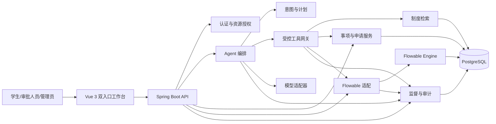

# 《基于 Agent 的大学生综合工作台系统的设计与实现》课题设计

## 1. 系统目标

UniAgent 面向大学生日常校园事务，使用自然语言 Agent 提供统一交互和任务协助，使用确定性业务服务与 Flowable 执行正式流程。学生可以从目标出发办理事项，无需预先了解主管部门、菜单位置和制度术语。

系统需要让 Agent 具备完成任务所需的制度知识、学生授权数据、事项表单和工作流工具，同时确保模型判断不能直接获得业务权限。任何正式状态变更都必须经过服务端鉴权、参数和状态校验、必要的用户确认及执行结果核验。

## 2. 设计原则

1. Agent 负责理解、澄清、规划和辅助，业务服务负责授权、规则、事务和状态变更；
2. 可由程序确定的字段、时间、权限和状态规则不交给模型裁决；
3. Agent 仅访问当前任务需要的最小数据和白名单工具；
4. 制度结论必须使用适用且有效的证据，无依据或冲突时拒绝确定性回答；
5. 写操作必须预览，关键操作由可信界面确认，不能以聊天中的隐式同意代替；
6. 工具调用成功后必须核验正式业务状态，不能把接口成功等同于业务完成；
7. Agent 故障不阻断传统菜单、表单和人工审批；
8. 会话、模型、知识、工具、业务与工作流全程关联和审计。

## 3. 总体架构

系统采用模块化单体，减少分布式部署和数据一致性成本。各模块保持接口边界，便于单独测试和替换模型服务。

## 4. 组件职责

| 组件 | 负责 | 不负责 |
| --- | --- | --- |
| 前端工作台 | 自然语言与传统菜单双入口、表单、确认、任务和轨迹展示 | 不在客户端决定权限或业务状态 |
| Agent 编排 | 意图识别、澄清、计划、知识与工具选择、结果表达 | 不直接写库，不直接调用 Flowable，不作审批决定 |
| 工具网关 | 工具发现、Schema 校验、逐次授权、确认、幂等和审计 | 不信任模型提供的身份与授权陈述 |
| 业务服务 | 用户、事项、表单、附件、规则、资源权限和事务 | 不依赖模型维持基础流程可用 |
| Flowable | 流程定义、任务、网关、消息事件和历史轨迹 | 不承担自然语言理解和业务资源授权 |
| 知识服务 | 制度版本、适用范围、检索、引用和冲突标记 | 不以历史或非官方材料支持高风险结论 |
| 监督模块 | 事件账本、Trace、指标、告警、一致性巡检和时间线 | 不自动篡改业务或 Flowable 状态 |
| 审批人员 | 核验原始材料并作出正式决定 | 不以 Agent 摘要替代责任判断 |

## 5. 核心业务设计

### 5.1 请假与销假

请假/销假是端到端主流程。学生可由 Agent 引导或传统表单创建草稿，完成规则和材料检查后核对并确认提交。辅导员处理首级审批；请假超过演示阈值或离校时进入学院审批；退回后学生修改并从辅导员节点重新提交；请假生效前允许撤回，生效后通过销假结束流程。

可执行 BPMN、流程变量、退回和撤回边界以《流程与数据模型设计》为准。

### 5.2 奖助学金辅助

Agent 基于学生明确授权的信息和当前有效制度完成政策解释、资格初筛、材料清单及一致性检查。结果分为可能符合、明显不符合和资料不足，并展示依据和缺失信息。结果不构成资格认定，不自动进入评审结论。

### 5.3 模板化事项

证明申请用于验证短流程和材料生成，活动或场地申请用于验证附件、条件分支和多级审批。模板事项复用事项目录、通用申请、工作流适配和审计能力。

## 6. Agent 稳定执行

Agent 使用“理解—澄清—计划—检索—授权—确认—执行—验证”的闭环。意图识别先从已发布事项目录召回候选，再由模型完成重排和参数提取，最后由事项 Schema 和业务规则校验。低置信度、多候选或关键字段缺失时进入澄清，不执行写操作。

计划由结构化步骤组成，每一步明确前置条件、知识、工具、参数、风险、确认要求、成功判据和失败处理。Agent 会话状态与业务申请、Flowable 运行状态相互分离。完整状态机、证据等级、置信门控和执行后核验规则以《Agent 稳定执行与全链路监督设计》为准。

## 7. 知识与上下文

制度文档记录来源、版本、生效和失效时间、适用校区、学院、年级、身份、审核状态及内容校验值。检索使用关键词和向量混合召回、元数据过滤和重排序。

每次模型调用只组装当前任务所需内容：当前角色和脱敏身份、已确认目标、必要会话事实、事项及表单定义、允许动作、有效制度片段和候选工具。敏感信息只有在当前事项必要且取得字段级授权时进入上下文，不默认形成长期记忆。

## 8. 工具与权限

Agent 工具按公开只读、受限只读、只读计算、可逆写入、关键写入和人工决定分级。事项和制度检索可自动执行；本人数据按字段授权；保存草稿受资源和版本限制；提交、撤回和销假需要一次性确认凭证；审批工具永不开放给 Agent。

工具名称、请求响应、授权条件、确认机制、错误码和角色权限矩阵以《Agent 工具与权限契约》为唯一依据。

## 9. 数据与状态

核心领域对象包括账号与角色、学生资料、事项定义、申请、申请版本、附件、审批记录、用户确认、Agent 会话与执行、制度文档与片段、反馈和归档记录。

业务申请使用 `businessKey` 与 Flowable 流程实例逻辑关联。Agent 状态回答“智能任务进行到哪里”，业务状态回答“申请处于什么阶段”，Flowable 记录实际活动节点和历史。实体字段、ER 图、状态词表、唯一约束、事务与幂等规则以《流程与数据模型设计》为准。

## 10. 审查与降级

系统依次审查输入安全、意图匹配、制度证据、工具权限、写入确认、执行状态和最终输出。用户输入、附件、制度片段及工具结果均作为不可信数据，不能改变系统权限和工具规则。

模型超时或格式错误可有限重试或切换适配模型；规则明确时降级为确定性校验；知识不足时拒答；写工具结果未知时先查询状态；权限和安全失败直接阻断；状态冲突冻结后续写操作并转人工。最终兜底为只读说明、人工接管和传统官方入口。

## 11. 全链路监督

系统使用根关联 ID 连接用户请求、Agent Run、模型调用、RAG 检索、工具调用、业务事务、申请、流程实例、人工任务、审批、通知和归档。

统一事件账本保存关键业务事实，OpenTelemetry 定位技术耗时与错误，指标和告警发现系统性异常，一致性巡检核对业务状态与 Flowable 活动节点。管理员可通过申请编号重建关键时间线。监督体系只报告和定位异常，不授权 Agent 自动修复正式状态。

## 12. 安全与非功能要求

- 认证信息、令牌和模型密钥不进入模型上下文或普通日志；
- 后端按角色、组织范围、资源归属和当前流程节点逐次授权；
- 输入和工具参数使用白名单 Schema，文件校验大小、类型和归属；
- 关键写操作使用二次确认、幂等键和乐观锁；
- 模型、Prompt、知识、事项、表单和流程定义均记录版本；
- 普通业务接口满足论文实验环境中的可交互响应要求；
- 模型不可用时核心请假/销假流程仍可完成；
- 所有研究数据使用虚构、公开或脱敏内容。

## 13. 研究验证

系统设置传统菜单与表单基线组、Agent 协助实验组、无检索问答基线和必要的消融组。评价内容包括：

- 事项识别准确率、Top-k 召回率和澄清有效率；
- 办理任务完成率、耗时、步骤数和字段错误；
- 材料预审 Precision、Recall、F1 和误报率；
- 制度问答正确率、引用正确率、拒答率和幻觉率；
- 工具选择准确率、危险调用拦截率和状态核验覆盖率；
- Agent 故障时核心流程可用率；
- 单个申请关键时间线的审计完整性。

论文不以模型达到预设理想指标为成立前提。效果较好时论证效率价值；效果一般时通过错误分析和消融实验说明制度证据、确定性规则、人工确认与降级机制的必要性。

## 14. 设计文档关系

- 《课题规划》定义研究问题、范围、创新点和成果；
- 《需求规格与验收》定义用例、优先级和可测试验收条件；
- 《流程与数据模型设计》定义 BPMN、状态、ER 和一致性；
- 《Agent 工具与权限契约》定义受控能力入口和授权边界；
- 《Agent 稳定执行与全链路监督设计》定义运行、审查、降级和追溯机制。

各专项文档独立承担详细定义，本文只维护系统级结构和关键设计决策。
