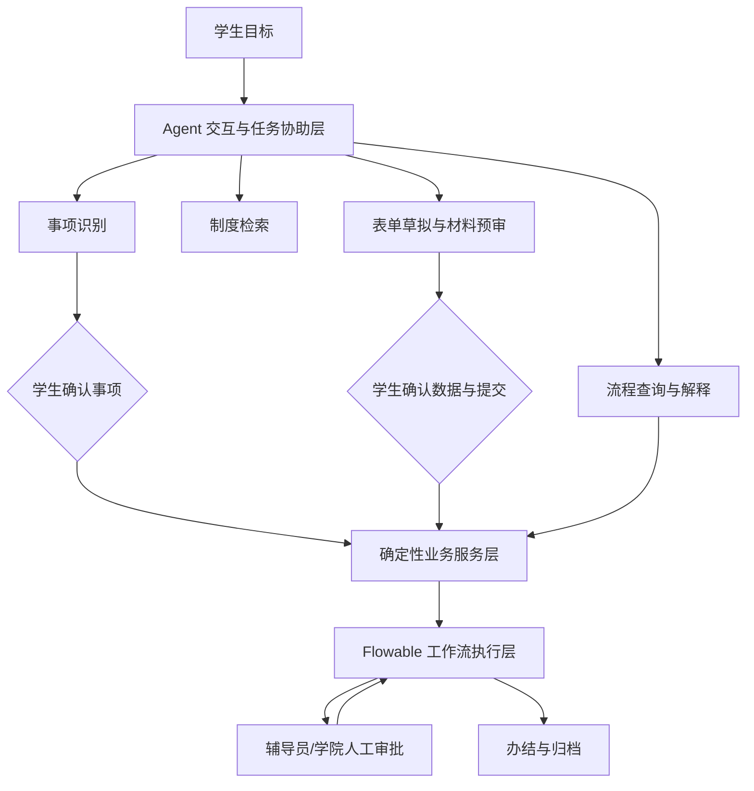
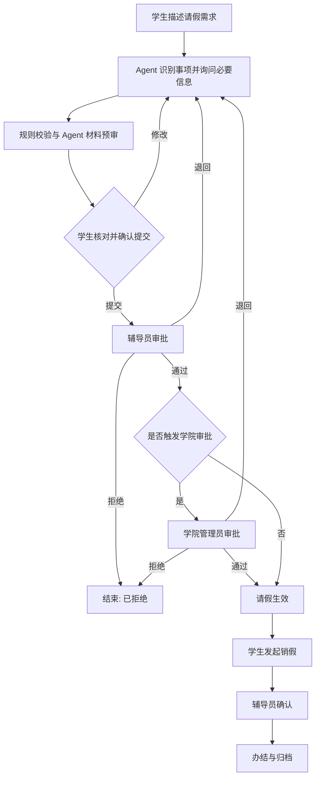
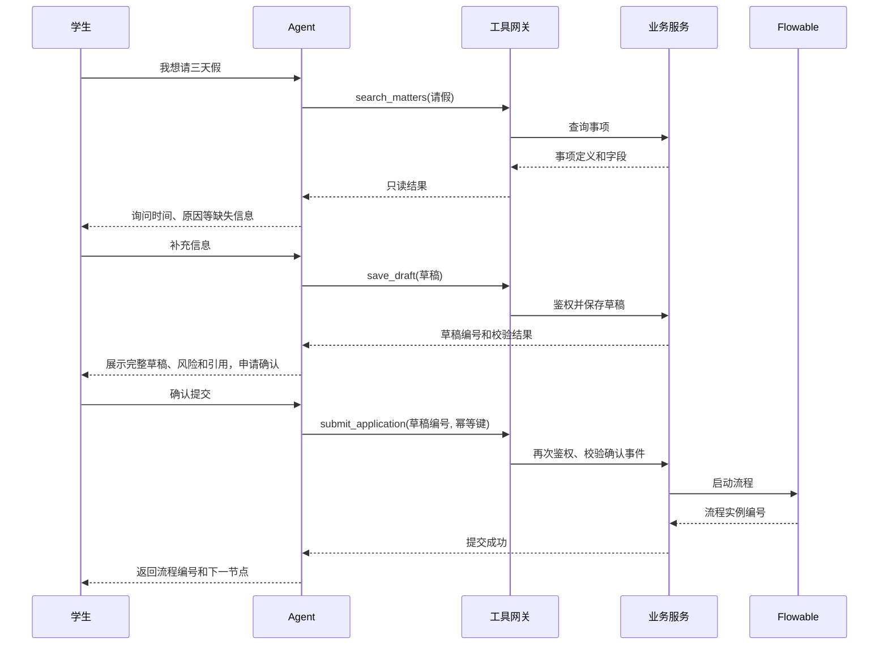
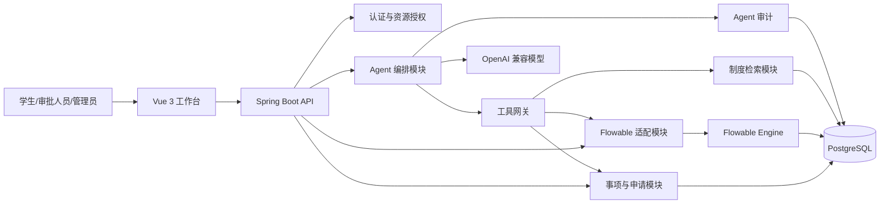

# 《基于 Agent 的大学生综合工作台系统的设计与实现》课题设计

## 1. 设计目标

系统暂定名为 UniAgent。它面向大学生日常校园事务，以自然语言 Agent 作为统一交互和任务协助入口，以工作流引擎作为正式业务执行基础。

学生不需要先了解事项属于哪个部门，可以从目标出发发起任务。Agent 通过事项检索识别业务，通过制度知识库解释规则，通过表单工具形成草稿，通过预审工具发现材料问题，通过工作流查询工具解释进度。任何正式提交、撤回及审批动作均受权限、状态、参数校验和人工确认约束。

## 2. Agent 主线与工作流基础

### 2.1 职责划分

| 组件 | 负责 | 不负责 |
| --- | --- | --- |
| Agent | 意图识别、任务分解、信息追问、知识检索、表单草拟、材料分析、流程解释 | 不直接审批，不绕过确认，不直接写数据库 |
| 业务服务 | 用户、事项、表单、附件、规则、权限和事务 | 不依赖模型维持基本业务可用 |
| Flowable | 流程定义、任务分配、网关、状态流转和历史轨迹 | 不处理自然语言理解和制度解释 |
| 学生 | 提供信息、授权数据使用、核对并确认提交 | 不需要理解底层流程定义 |
| 审批人员 | 核验材料、处理例外、作出正式决定 | 不以 Agent 建议替代责任判断 |

### 2.2 双层协同模型

Agent 能提出“做什么”和“如何准备”，但只有业务服务可以在通过鉴权、状态及参数校验后执行“正式操作”。

## 3. 用户故事

### 3.1 学生

- 作为学生，我可以描述想办的事情，由系统推荐合适事项并解释选择依据；
- 我可以让 Agent 逐项询问信息并形成申请草稿；
- 我可以看到草稿引用了哪些个人资料，并决定是否允许使用；
- 我可以在提交前获取材料清单、缺失项和制度风险提示；
- 我必须核对最终表单后主动确认提交；
- 我可以用自然语言查询“现在到哪一步”“为什么退回”“下一步做什么”；
- 我可以查看原始审批意见和完整流程轨迹，不只依赖 Agent 转述；
- 我可以对 Agent 建议标记采纳、修改或无用。

### 3.2 审批人员

- 我只能看到权限范围内的任务和申请；
- 我可以查看结构化摘要、引用和待核验项，也可以访问原始材料；
- 我独立作出通过、退回或拒绝决定，并填写理由；
- 系统记录我的决定，但不让 Agent 代替我提交。

### 3.3 管理员

- 我可以配置事项与 BPMN 流程的绑定关系；
- 我可以维护制度文档和生效版本；
- 我可以配置 Agent 可调用的工具与敏感操作确认策略；
- 我可以查询脱敏后的调用质量、失败率和采纳率。

## 4. 功能边界

### 4.1 必须完成

- 身份认证与学生、辅导员、学院管理员、系统管理员四类角色；
- 事项目录和 Agent 事项导航；
- 请假/销假完整工作流；
- Agent 引导填表与提交前确认；
- 规则校验和材料语义预审；
- 待办、已办、我发起的及流程轨迹；
- 带引用的制度问答；
- 工具调用、模型输出和用户采纳审计；
- 模型关闭或失败时的传统菜单办理模式。

### 4.2 应当完成

- 奖助学金资格解释、材料清单和申请流程；
- 审批材料摘要与待核验项；
- 在读证明或活动申请中的至少一个模板流程；
- 办结摘要、标签和归档建议；
- Agent 效果对照实验。

### 4.3 可选完成

- 多 Agent 分工；
- 长期个性化记忆；
- 语音输入；
- 流程预测和主动提醒；
- 流程可视化设计器。

多 Agent 并非题目成立的必要条件。若一个编排 Agent 加若干确定性工具已经满足需求，不为展示概念而增加多 Agent 通信复杂度。

## 5. 代表性业务设计

### 5.1 请假/销假主流程

请假类型、时长和是否离校可作为条件网关变量。阈值由演示事项配置给出，不声称代表某所真实高校制度。

### 5.2 奖助学金流程

Agent 根据学生明确授权的基础信息和制度条款进行条件初筛，输出“可能符合”“明显不符合”或“资料不足”，同时列出判断依据和缺少的信息。结果只用于准备申请，不构成资格认定。

学生确认后进入申请流程，辅导员核验、学院评审、公示和办结等节点可在原型中适度简化。实验重点放在政策问答、材料清单与一致性检查，不模拟真实评奖结果。

### 5.3 证明与活动模板流程

证明申请用于验证短流程和自动生成材料；活动申请用于验证附件、场地冲突提示和多级审批。两者只需完成代表性流程，不追求覆盖所有校园业务。

## 6. Agent 任务编排

### 6.1 任务状态

Agent 会话内部使用受控任务状态：`UNDERSTANDING`、`CLARIFYING`、`DRAFTING`、`VALIDATING`、`AWAITING_CONFIRMATION`、`EXECUTING`、`COMPLETED`、`FAILED`。

`AWAITING_CONFIRMATION` 是所有有状态写操作之前的强制节点。模型输出不能自行将状态改为 `EXECUTING`，只有用户确认事件和后端校验共同触发。

### 6.2 上下文组成

每次调用按需包含：

- 当前用户角色和脱敏身份标识；
- 当前会话目标与已确认信息；
- 事项定义、表单字段和校验规则；
- 当前流程节点和允许动作；
- 检索到的制度片段及版本；
- 最近必要的对话，不默认携带全部历史；
- 工具说明和参数模式。

奖助、健康和家庭等敏感字段只有在当前事项必需且学生明确操作时才进入上下文，不写入普通应用日志。

### 6.3 工具集合

| 工具 | 类型 | 作用 | 保护措施 |
| --- | --- | --- | --- |
| `search_matters` | 只读 | 检索事项与办理条件 | 返回公开事项信息 |
| `search_policies` | 只读 | 检索制度片段 | 返回来源、版本和位置 |
| `get_student_profile` | 敏感只读 | 获取授权的基础资料 | 字段级授权与脱敏 |
| `validate_application` | 只读计算 | 执行确定性规则 | 不调用模型作最终判定 |
| `save_draft` | 可逆写入 | 保存申请草稿 | 限本人、版本控制 |
| `submit_application` | 关键写入 | 启动工作流 | 二次确认、幂等键、后端重校验 |
| `query_process` | 受限只读 | 查询本人或授权任务状态 | 资源级权限检查 |
| `withdraw_application` | 关键写入 | 撤回允许撤回的申请 | 二次确认、状态检查 |

审批工具不开放给学生 Agent。审批人员的动作通过独立页面和后端接口完成。

### 6.4 工具调用时序

## 7. 工作流与状态设计

业务申请状态为 `DRAFT`、`READY`、`IN_REVIEW`、`RETURNED`、`APPROVED`、`REJECTED`、`WITHDRAWN`、`EFFECTIVE`、`CANCELLATION_PENDING`、`COMPLETED`、`ARCHIVED`。

Flowable 运行状态是流程任务的权威来源；业务状态是供页面查询和领域规则使用的投影。申请使用 `businessKey` 关联流程实例，提交、审批和状态投影更新需满足事务与幂等要求。

Agent 会话状态与业务申请状态分离。对话完成不表示申请已提交，Agent 说“已完成”也不能作为业务状态变更依据。

## 8. 权限与安全设计

- 认证后端统一执行，模型不接触密码、令牌和数据库凭据；
- 工具网关根据用户、角色、资源归属、流程节点和动作逐次授权；
- Agent 仅能调用白名单工具，不能构造 SQL 或访问 Flowable 内部表；
- 所有写工具校验结构化参数，关键操作要求二次确认；
- 使用幂等键和乐观锁阻止重复提交；
- 制度文档中的文本视为数据，不能覆盖系统工具规则，防范间接提示词注入；
- 上传文件校验大小、类型和归属，实验环境不使用真实敏感材料；
- 模型密钥放在环境变量中，不提交到代码仓库；
- 记录工具、参数摘要、授权结果、引用、模型版本、耗时和用户反馈；
- 模型失败时返回传统表单入口，保证工作流核心功能可用。

## 9. 总体架构

## 10. 核心数据模型

- `user`、`role`、`user_role`：账号与角色；
- `student_profile`：演示用学生基础资料及字段授权状态；
- `matter_definition`：事项、说明、表单模式、流程定义键和启用状态；
- `application`：申请人、表单数据、业务状态、版本和流程实例；
- `attachment`：附件元数据及安全存储位置；
- `approval_record`：节点、办理人、动作、意见和时间；
- `agent_session`：会话目标、任务状态和关联事项；
- `agent_message`：必要的会话消息与脱敏标记；
- `agent_execution`：模型、Prompt 版本、工具调用、引用、耗时和状态；
- `user_confirmation`：关键操作确认内容、时间和幂等键；
- `policy_document`、`policy_chunk`：制度文档、版本和检索片段；
- `agent_feedback`：建议采纳、修改、拒绝和评分；
- `archive_record`：办结摘要、标签与材料清单；
- Flowable 自有运行及历史表。

## 11. 非功能要求

- 安全：敏感数据最小化、资源级授权、工具白名单和关键操作确认；
- 可靠：Agent 超时、无效结构化输出和外部模型故障均可降级；
- 可解释：事项推荐、资格提示和制度回答尽量展示来源；
- 可追溯：用户确认、工具调用、流程操作和审批决定均可审计；
- 可替换：模型通过兼容接口接入，业务规则不绑定具体模型；
- 可用：同时提供自然语言入口和传统菜单入口；
- 可测试：Agent、工具网关和工作流可分别使用 Mock 进行确定性测试。

## 12. 实验方案

### 12.1 实验组设置

- 基线组：传统菜单、搜索和表单操作；
- 实验组：Agent 事项导航、对话填表、材料预审和流程解释；
- RAG 子实验基线：相同模型不提供制度检索；
- 消融实验：移除节点上下文或移除确定性规则，观察效果变化。

### 12.2 数据集

- 事项导航：100—150 条学生自然语言请求，包含别名、口语、模糊与多意图；
- 材料预审：50—100 份虚构申请，包含缺失、冲突和制度不符；
- 制度问答：50—100 个有答案、多条款和知识库外问题；
- 工具安全：30—50 个未确认、越权、重复、注入和异常参数用例；
- 可用性任务：请假、奖助和证明等典型任务，小规模用户实验。

### 12.3 指标

- Agent：事项识别准确率、Top-k 召回率、澄清有效率和工具选择准确率；
- 预审：Precision、Recall、F1、误报率和问题定位准确率；
- RAG：答案正确率、引用正确率、拒答率和幻觉率；
- 安全：危险调用拦截率、越权拦截率、确认覆盖率和审计完整率；
- 效率：任务完成率、平均时间、交互步骤、字段错误和补交次数；
- 人机协同：建议采纳率、正确建议采纳率和错误建议拒绝率。

### 12.4 论文成立条件

论文不以模型达到某个理想指标作为成立前提。若 Agent 效果较好，论证受控 Agent 工作台的效率价值；若效果一般，则通过消融与错误分析说明流程上下文、规则和人工确认的必要性。系统至少需要证明：Agent 的错误不会绕过权限和确认直接改变正式流程。

## 13. 开发与论文映射

| 研究内容 | 最小代码产物 | 论文证据 |
| --- | --- | --- |
| Agent 统一入口 | 意图识别、事项检索、会话状态 | 准确率、错误路由案例 |
| 对话式办理 | 表单草稿与确认工具 | 完成时间、步骤和字段错误 |
| 工作流执行 | 请假/销假 BPMN 和任务接口 | 路径、状态及异常测试 |
| 制度知识增强 | 文档切分、检索、引用 | 正确率、引用率和拒答率 |
| 受控工具调用 | 工具网关、鉴权、幂等和审计 | 越权、注入和重复调用测试 |
| 人机协同 | 审批摘要、原文查看和反馈 | 采纳率与错误建议拒绝率 |

代码只实现支撑上述研究问题和实验所需的最小系统，不扩展无关大屏、复杂微服务或全校业务。

## 14. 后续设计顺序

1. 固化学生事务用例和验收标准；
2. 输出请假/销假 BPMN、Agent 任务状态和工具契约；
3. 输出数据库 ER 图、权限矩阵和关键时序；
4. 制定实验数据格式、标注规范和指标计算方法；
5. 制作低保真交互原型，验证自然语言与传统菜单双入口；
6. 设计稳定后再实现最小 Demo；
7. 根据 Demo 与实验结果重写正式开题报告。
