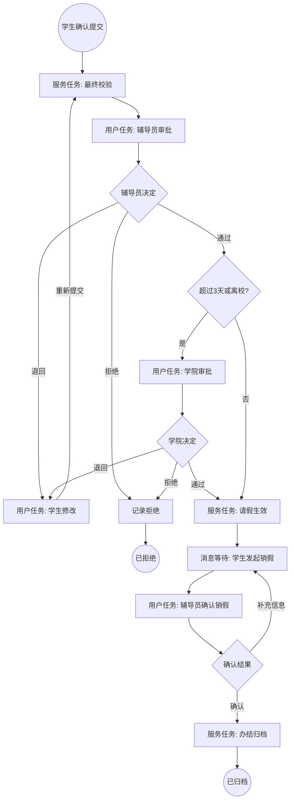
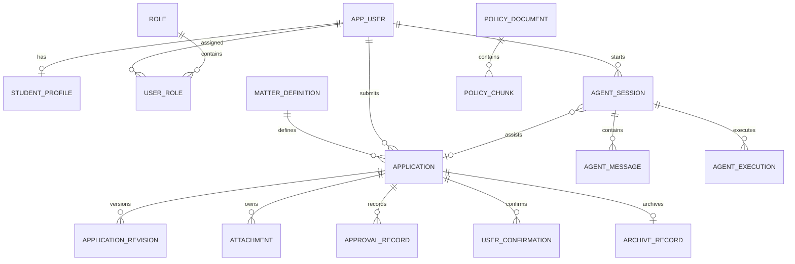

# UniAgent 流程与数据模型设计

## 1. 设计原则

Agent 会话状态、业务申请状态与 Flowable 运行状态必须分离。Agent 完成一次对话不代表业务办结；业务状态只由经过鉴权的业务服务更新；Flowable 状态通过运行时任务、事件订阅和历史记录表达，不另造一个与引擎假定一一对应的状态枚举。

## 2. 请假/销假流程假设

以下为原型演示规则，不代表真实高校制度：

- 请假不超过 3 天且不离校，只需辅导员审批；
- 请假超过 3 天或离校，需要学院管理员复审；
- 审批可以通过、退回或拒绝；
- 退回后重新提交从辅导员审批开始；
- 请假生效前可以撤回，生效后只能销假；
- 销假由辅导员确认后办结归档。

## 3. 可执行 BPMN 逻辑

流程定义键：`student_leave`

业务键：`LEAVE:{applicationId}`

流程级中断消息事件 `LEAVE_WITHDRAW_REQUESTED` 覆盖辅导员审批、学院审批和学生修改节点。撤回前，业务服务必须验证申请归属、业务状态、活动节点、确认令牌和幂等键。

销假消息为 `LEAVE_CANCELLATION_REQUESTED`，使用业务键关联唯一运行实例。

## 4. 节点与变量

| 节点 | BPMN 类型 | 办理方 | 业务状态 |
| --- | --- | --- | --- |
| 最终校验 | Service Task | 业务服务 | READY → IN_REVIEW |
| 辅导员审批 | User Task | `${counselorGroup}` | IN_REVIEW |
| 学院审批 | User Task | `${collegeAdminGroup}` | IN_REVIEW |
| 学生修改 | User Task | `${applicantUserId}` | RETURNED |
| 请假生效 | Service Task | 业务服务 | EFFECTIVE |
| 等待销假 | Message Catch | 学生触发 | EFFECTIVE |
| 确认销假 | User Task | `${counselorGroup}` | CANCELLATION_PENDING |
| 办结归档 | Service Task | 业务服务 | COMPLETED → ARCHIVED |

流程变量只保留路由和分配需要的信息：`applicationId`、`applicantUserId`、`counselorGroup`、`collegeAdminGroup`、`leaveDays`、`offCampus`、`collegeApprovalRequired`、`decision`、`cancellationDecision` 和 `applicationVersion`。

完整表单、附件、Agent 对话、长审批意见和敏感信息不保存为流程变量，通过 `applicationId` 从业务服务读取。

## 5. 三类状态

### 5.1 Agent 任务状态

Agent 运行状态独立于业务申请与 Flowable，用于表达理解、澄清、规划、检索、确认、执行、验证、等待、降级和结束等阶段。状态枚举、转换条件与失败分支以《Agent 稳定执行与全链路监督设计》为唯一依据。

### 5.2 业务申请状态

`DRAFT`、`READY`、`IN_REVIEW`、`RETURNED`、`REJECTED`、`WITHDRAWN`、`EFFECTIVE`、`CANCELLATION_PENDING`、`COMPLETED`、`ARCHIVED`。

### 5.3 Flowable 运行状态

- 运行时存在流程实例：流程运行中；
- 当前用户任务或消息订阅：流程等待的节点；
- 仅存在历史实例：流程已结束；
- 历史任务、结束原因和变量记录：形成流程轨迹。

关键约束：`agent_session.status = COMPLETED` 不能推出 `application.status = COMPLETED`。

## 6. ER 模型

Flowable 表与 `application.process_instance_id`、`business_key` 逻辑关联，不建立由 JPA 管理的跨表外键，也不直接修改引擎内部表。

## 7. 核心实体

### 7.1 application

- `id`：UUID 主键；
- `application_no`：用户可见唯一编号；
- `matter_id`、`applicant_user_id`；
- `form_data`：JSONB 当前草稿；
- `status`、`current_revision_no`；
- `process_definition_key`、`process_definition_version`；
- `process_instance_id`、`business_key`，均唯一且草稿阶段可空；
- `submitted_at`、`effective_at`、`completed_at`；
- `version`：乐观锁；
- 创建与更新时间。

### 7.2 application_revision

每次首次提交或退回后重提生成不可变快照，包含 `application_id`、`revision_no`、`form_data`、`validation_result`、`submitted_by` 和 `submitted_at`。唯一约束为 `(application_id, revision_no)`。

### 7.3 approval_record

记录申请、流程任务、节点、申请版本、办理人、动作、意见和时间。动作限制为 `APPROVE`、`RETURN`、`REJECT`、`CONFIRM_CANCELLATION`、`RETURN_CANCELLATION`。

### 7.4 agent_session 与 agent_execution

会话保存用户目标、任务状态、关联事项和申请。执行记录保存模型、Prompt 版本、工具调用摘要、引用、耗时、结果状态及用户采纳结果。敏感原文不得重复写入普通日志。

### 7.5 user_confirmation

保存确认动作、资源、资源版本、参数摘要哈希、状态、签发与过期时间及消费时间。确认凭证必须一次性使用，并绑定用户、会话、动作、资源和版本。

## 8. 数据一致性

- 创建草稿不启动流程；
- 提交事务先锁定并校验草稿、消费确认凭证、生成版本快照，再启动流程并保存实例关联；
- 提交接口使用 `user + action + resource + idempotency_key` 唯一约束；
- 审批接口验证任务办理权和 `application.version`，再完成任务并写审批记录；
- 撤回和审批并发时依靠乐观锁及任务状态确保只有一个结果成功；
- 退回重提重新计算路由变量，不能沿用旧版本计算结果；
- 新流程定义只用于新申请，运行中的实例继续使用启动时版本；
- 状态投影异常时以 Flowable 历史和业务审计进行核对，不由 Agent 修复。
